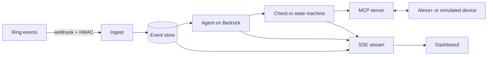

# Kin

> An agent that watches Ring activity for an elderly parent, notices when the day looks wrong, and has Alexa+ check in first, so family is alerted only when it matters.

<!-- TODO: final name and tagline. Add demo GIF and video link here before submitting. -->

Built for the [Build, Ship, Shape: Amazon Developer Hackathon](https://amazonappdev2026.devpost.com/).
**Tracks:** Ring, Alexa+ · **Mini challenges:** AWS Builder, Open Source

---

## The problem

Families of people who live alone get one of two things: silence until something goes wrong, or a flood of alerts they learn to ignore. Neither tells you whether today is actually unusual for that person.

## What Kin does

1. **Learns the routine.** Door and motion activity from Ring becomes a picture of a normal day.
2. **Judges today.** An agent on Amazon Bedrock compares today to that routine and explains its reasoning in plain English.
3. **Checks in first.** When something looks off, the person is asked if they're okay before anyone is alarmed.
4. **Escalates only if needed.** No answer, or a worrying answer, raises an alert for family.
5. **Answers the family.** Through Alexa+, a family member can ask "How is the day going?" and get a real answer.

## What is real and what is simulated

Be skeptical of any project that blurs this. Ours:

| Piece | Status | Notes |
|---|---|---|
| Ring events | Simulated | Scripted scenarios in Ring webhook format. <!-- TODO: update if a real Ring account is connected --> |
| Ring webhook receiver (HMAC check) | ⬜ Planned | Flip to ✅ when merged |
| Agent on Amazon Bedrock | ⬜ Planned | Flip to ✅ when merged |
| MCP server (Streamable HTTP, `/mcp`) | ⬜ Planned | Flip to ✅ when merged |
| Alexa+ surface | ⬜ Planned | <!-- TODO: real Alexa+ web simulator, or our simulated device --> |
| Family notification | Simulated | Banner on the dashboard, no real SMS or push |
| All people and data | Fictional | |

## Architecture



Full detail: [`docs/ARCHITECTURE.md`](docs/ARCHITECTURE.md). API and event shapes: [`docs/CONTRACT.md`](docs/CONTRACT.md).

## Tech stack

- **Server:** TypeScript, official MCP SDK (Streamable HTTP), AWS SDK v3
- **AI:** Amazon Bedrock (Converse API)
- **Dashboard:** Next.js, dark-only UI
- **Hosting:** <!-- TODO: server host --> and Vercel (dashboard)

## Repo layout

```
server/        Backend: Ring ingest, agent, check-in state machine, MCP server, SSE
dashboard/     Live dashboard and simulated Alexa device
scripts/       Scenario simulator (signed Ring-format webhooks)
docs/          Architecture, contract, task board
FRICTION.md    Friction log for Ring, Alexa+, MCP, Bedrock
CONTRIBUTING.md  How the two of us work
AGENTS.md      Context for AI coding tools
```

## Getting started

> Commands below become valid as the matching tasks in [`docs/TASKS.md`](docs/TASKS.md) are merged. <!-- TODO: verify every command before submitting -->

```bash
# 1. Configure
cp .env.example .env        # then fill in the values

# 2. Server
cd server
npm install
npm run dev                 # http://localhost:3000, MCP at /mcp

# 3. Dashboard (new terminal)
cd dashboard
npm install
npm run dev                 # http://localhost:3001
# Set NEXT_PUBLIC_MOCK=1 to run the dashboard without the server
```

### Environment variables

| Name | Purpose |
|---|---|
| `AWS_REGION` | Region for Bedrock |
| `AWS_ACCESS_KEY_ID`, `AWS_SECRET_ACCESS_KEY` | AWS credentials (never commit) |
| `BEDROCK_MODEL_ID` | Model used by the agent |
| `RING_WEBHOOK_HMAC_KEY` | Verifies incoming Ring webhooks |
| `MCP_PORT` | Server port (default 3000) |
| `DASHBOARD_ORIGIN` | Allowed CORS origin for the dashboard |

## MCP tools

| Tool | What it does |
|---|---|
| `get_day_summary` | Summarizes today's activity and status |
| `get_status` | Current status, open check-in, last decision |
| `start_checkin` | Opens a check-in with a deadline |
| `record_checkin` | Records the person's answer |
| `escalate_to_family` | Raises a family alert |

Test with the MCP Inspector against `http://localhost:3000/mcp`.

## Demo scenarios

| Scenario | Shows |
|---|---|
| `normal-day` | Routine activity, agent stays calm |
| `missed-morning` | No usual activity, check-in, no reply, escalation |
| `night-visitor` | Unexpected activity at night, escalation with context |

Start one from the dashboard, or via `POST /api/sim/start`.

## Built with AI assistance

<!-- TODO: list the AI tools we actually used. Must match the Devpost form. -->

## Team

- Adi ([@AdityaKumar1511](https://github.com/AdityaKumar1511)): backend, agent, MCP, deployment
- Sweety ([@sg293307-cmd](https://github.com/sg293307-cmd)): dashboard, design, demo assets

## Contributing

See [`CONTRIBUTING.md`](CONTRIBUTING.md).

## Licence

MIT. See [`LICENSE`](LICENSE).
