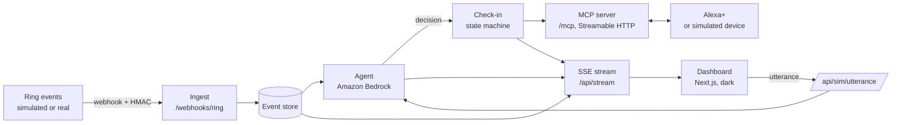
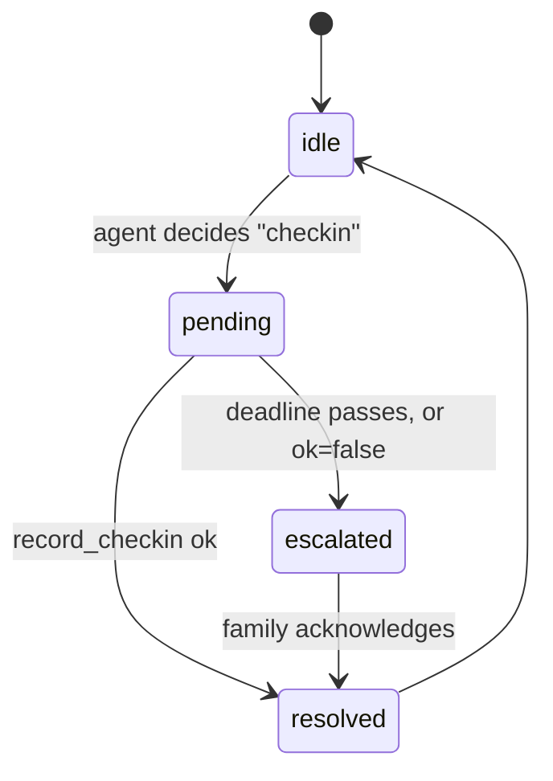

# Architecture

Kin watches home activity from Ring, decides whether a day looks normal, checks in with the person first, and only alerts family when it matters. Alexa+ is the voice layer, exposed through an MCP server.

## 1. System overview

## 2. Components

| Component | Responsibility | Location | Owner |
|---|---|---|---|
| Ring ingest | Receive webhooks, verify HMAC, normalize to `RingEvent` | `server/src/ring/` | A |
| Event store | Hold today's events, decisions, check-in, escalations (in memory with JSON snapshot, no database for the MVP) | `server/src/store/` | A |
| Routine model | Compute what "normal" looks like from past days of events (rules first) | `server/src/agent/routine.ts` | A |
| Agent | Ask Amazon Bedrock to judge today against the routine, return `AgentDecision` as structured JSON | `server/src/agent/` | A |
| Check-in state machine | `pending`, `resolved`, `escalated`, with timeouts | `server/src/agent/checkin.ts` | A |
| MCP server | Expose the five tools over Streamable HTTP | `server/src/mcp/` | A |
| Simulators | Replay scripted scenarios as signed Ring-format webhooks | `scripts/` | A |
| Dashboard | Live event stream, reasoning panel, simulated Alexa device, family view | `dashboard/` | B |

## 3. Data flow

**Normal day.** Ring event arrives, ingest verifies and stores it, the agent compares the day to the routine, decision is `normal`, and the dashboard shows it via SSE.

**Missed morning.**
1. No usual activity by the expected time, so the agent decides `checkin` with a plain-English reason.
2. The state machine opens a check-in with a deadline and the simulated device shows a prompt.
3. The parent answers: `record_checkin(ok: true)` resolves it.
4. No answer by the deadline: the state moves to `escalated` and `escalate_to_family` raises an alert on the family view.

**Family asks Alexa+.** "How is the day going?" Alexa+ calls `get_day_summary` over MCP, and the reply is spoken. In the simulator, `/api/sim/utterance` runs the same tool handlers and returns the tool-call trace so judges can see them.

## 4. Check-in state machine

## 5. Agent decision logic

1. **Rules first.** The routine model extracts simple signals: usual first-activity window, typical activity count, unusual hours.
2. **Bedrock second.** The model receives the routine summary plus today's events and returns JSON: `status`, `reason`, `confidence`, `basedOn`. The prompt requires the reason to cite specific events.
3. **Guardrails in code.** The state machine, not the model, owns timeouts and escalation. The model only recommends.
4. Output is validated against the contract types. Invalid output is retried once, then falls back to `normal` with a logged error.

## 6. Deployment

| Piece | Where | Notes |
|---|---|---|
| Server (ingest, agent, MCP, SSE) | A public HTTPS host (Railway, Render, or AWS) | Alexa+ needs a reachable endpoint to test an add-on |
| Dashboard | Vercel | Points at the server via `NEXT_PUBLIC_API_URL` |
| Bedrock | AWS | Needs model access enabled in the chosen region |

## 7. Security

- Ring webhooks are rejected unless the HMAC signature verifies.
- Secrets live in environment variables only (`.env.example` lists names).
- The server applies a request size limit and rate limiting on public endpoints.
- All demo data is fictional.

## 8. Open questions (resolve and record the answer here)

| Question | Owner | Answer |
|---|---|---|
| Can an Alexa+ MCP add-on speak proactively, or only respond to the user? If only respond, the proactive prompt lives on the simulated device. | A | TODO |
| How long does Ring developer portal approval take, and can we receive real webhooks from a personal account? | A | TODO |
| Which Bedrock model ID and region do we use, and is access enabled? | A | TODO |
| Do we have access to the Alexa+ web simulator? If not, we use our own simulated device. | A | TODO |
| Exact Ring webhook payload fields and signature header | A | TODO |
